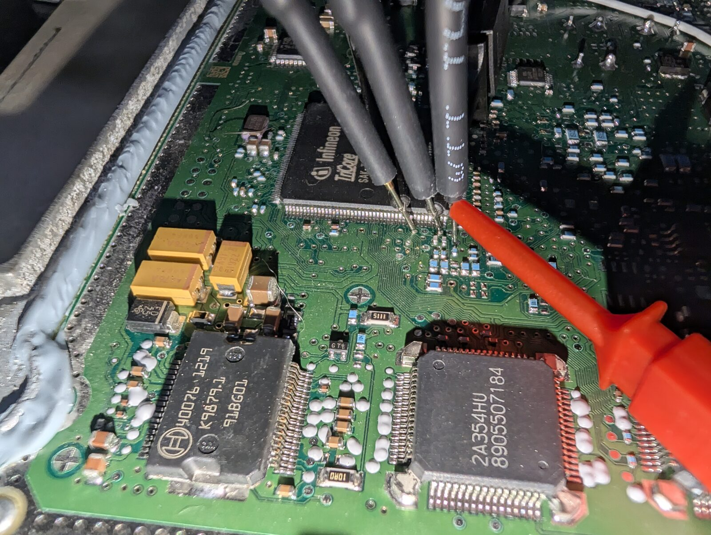
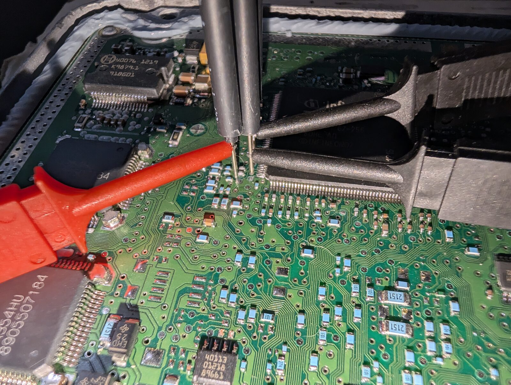
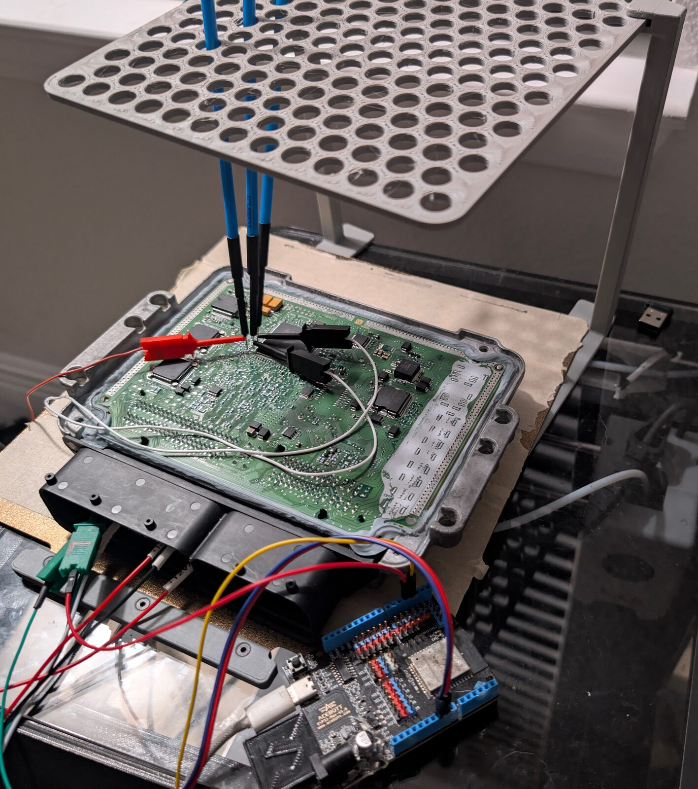

# Hardware requirements & wiring

The engine needs only a few low-cost signals. The split is deliberate: **you (the host) provide
logic-level signals; the bench provides power.**

## What the host must provide
Pick one transport; the loader's command logic is identical either way (`make` vs `make asc`):
- **CAN interface, active, at the target baud** (bench-proven 500 kbit/s). Any of: a PC/Pi CAN
  adapter (MCP2515 SPI HAT, gs_usb/candleLight, SocketCAN), or an MCU with a CAN controller +
  transceiver. It must be able to send/receive raw standard-id frames and be an *active* node
  (not listen-only) so it transmits and the ECU ACKs it.
- **or a plain UART** to the TC1767's ASC0 pins (`loader/asc/asc_io.c`), at whatever baud the
  BootROM autobauds to on your part. Point-to-point TX/RX is enough — no CAN controller needed.
  Bench-proven at a bitrate near 250 kbaud; the loader switches baud after upload (see
  `asc_io.c`'s `asc0_init`). If your TX physically loops back into your own RX (e.g. a shared
  half-duplex pair), the loader already discards its own echo — no host-side change needed.
- **Boot-strap drive** for CAN-BSL entry: the TC1767 `CNF1`/`BOOT` config pins must be held at the
  correct levels at reset. These are **logic-level, ~zero current** — a GPIO (level-shifted to the
  pin's voltage) or simple resistor straps suffice. For the MED17.9.8 / MEDG17.9.8 units the
  verified straps are **CNF1 HIGH** (to 3.3 V through a series resistor — 1 kΩ–3 kΩ both work; reads ~2.4–3.3 V at the pin) and **both BOOT pads
  LOW** (to GND through a single shared 1 kΩ) — full table in
  "[MED17.9.8 & MEDG17.9.8 — BSL strap & signal connections](#med1798--medg1798--bsl-strap--signal-connections)" below.
- **A way to reset/power-cycle the ECU on cue** (the BootROM only listens for BSL right after
  reset). Manual switch is fine; or a GPIO-driven MOSFET on the ignition/enable line.

## What the bench provides
- **ECU main power (12 V) from a proper bench supply.** An ECU draws amps; do **not** try to
  source this from a Pi/MCU. The host only provides signals + a common ground.
- **Common ground** between the host, any strap driver, and the ECU/PSU. (Omitting common ground
  is a classic cause of "nothing works".)

## Signals summary (per ECU board)
| Signal | Direction | Notes |
|---|---|---|
| CAN-H / CAN-L | host ↔ ECU | to the ECU's BSL CAN pins; 120 Ω termination at both ends |
| ASC0 TX/RX *(alternative to CAN)* | host ↔ ECU | **carried over the same CAN-H / CAN-L conductors** (half-duplex serial, not separate pins); the loader discards its own echo (see `loader/asc/asc_io.c`) |
| CNF1 / BOOT | host → ECU | config straps, sampled at reset; board-specific pad location |
| GND | common | mandatory |
| 12 V | PSU → ECU | bench supply, not the host |

## Bench connection diagram

CAN-H/CAN-L and 12 V/GND enter through the ECU **connector** (the pinout is harness-specific; on
the bench they are broken out through the diagnostic/OBD harness). `CNF1`/`BOOT` are **case-open**
pads at the TC1767 (see the per-ECU pad notes below).

```
  +12 V PSU ──[ relay ]──────────────► ECU 12 V      relay switches the HIGH side;
       │        (coil driven                          host GPIO drives the coil
       │         by host GPIO)
       └──── GND ──┬──── ECU GND ──── host GND ──── strap-driver GND   (one common ground)
                   │
  host CAN ── CAN-H ─────────────────── ECU CAN-H ┐  120 Ω at both ends;
  adapter  ── CAN-L ─────────────────── ECU CAN-L ┘  host is an ACTIVE node (not listen-only)
  (active,
   500 kbit/s)
                   CNF1  (pin 173) ──── 1–3 kΩ ── 3.3 V      (HIGH strap; ~2.4–3.3 V at pin)
                   BOOT  (pin 167) ─┐
                   BOOT  (pin 174) ─┴── 1 kΩ ──── GND        (LOW straps; may share one 1 kΩ)
```

## Verified bench setup (one known-good configuration)

The engine is adapter-agnostic; this is one configuration confirmed to enter BSL and upload the
loader on a TC1767 ECU:

- **CAN adapter:** Teensy 4.0 (FlexCAN) running a serial-line-CAN (slcan) sketch over USB, brought
  up as a SocketCAN netdev: `slcand -o -c -s6 /dev/ttyACM0 can0` (`-s6` = 500 kbit/s), then
  `ip link set up can0`.
- **Transceiver:** a TJA1051T/3 breakout with an on-board 3.3→5 V boost — logic/VIO at 3.3 V (safe
  for the host GPIO), transceiver rail at 5 V. **A 5 V transceiver fed only 3.3 V may pass SPI and
  internal loopback yet never frame the live bus** — give the transceiver its rated voltage.
- **Power:** 12 V bench supply switched **high-side** by a relay driven from a host GPIO
  (Raspberry Pi GPIO17).
- **Straps:** resistor straps on the TC1767 — CNF1 to 3.3 V through 1 kΩ–3 kΩ (reads ~2.4–3.3 V at the pin), both BOOT pads sharing one 1 kΩ to GND.
- **Command:**
  `connect --interface can0 --power-gpio 17 --power-off-ms 3500 --can-recover --frame-pace 0.005`

Timing and these values may need adjustment for other adapters, transceivers, and boards — see
[Entry timing](#entry-timing) and [Troubleshooting](#troubleshooting).

## MED17.9.8 & MEDG17.9.8 — BSL strap & signal connections

These two ECUs are **electrically identical** for native CAN-BSL entry; only the physical pad
locations differ (see the per-ECU pad notes below). BSL access is **case-open** (Module 53).
Values below are verified for these units.

| Signal | Connection at the ECU | Level / value at reset | Notes |
|---|---|---|---|
| CAN-H | host CAN-H ↔ ECU CAN-H | — | BSL CAN pair, 120 Ω at both ends; host active, 500 kbit/s |
| CAN-L | host CAN-L ↔ ECU CAN-L | — | same pair as CAN-H |
| ASC0 TX/RX | **over CAN-H / CAN-L** | — | serial alternative runs on the CAN pair (half-duplex); no separate serial pins |
| K-line | not used | — | this engine uses CAN, or ASC0 over the CAN pair; no K-line |
| CNF1 (HIGH strap) | **TC1767 pin 173**, to 3.3 V through a series resistor (**1 kΩ–3 kΩ both work**; ~3 kΩ used today) | **HIGH**, ~2.4–3.3 V at the pin | the single high strap; held high it selects the CAN-BSL boot path at reset. Series value isn't critical — target ~2.4–3.3 V at the pin |
| BOOT (LOW straps) | **TC1767 pins 167 & 174**, each to **GND through 1 kΩ** | **LOW** (pulled to ground) | the two BOOT pads; may share a **single 1 kΩ** at its ground connection |
| GND | common host ↔ strap driver ↔ ECU/PSU | 0 V | mandatory common ground |
| 12 V | bench PSU → ECU | 12 V | ECU draws amps — bench supply, never the host |

**TC1767 BSL strap set:** the full boot-strap set on the TC1767 is `145-L, 167-L, 173-H, 174-L`.
For **Bosch / Kefico ECUs** (including MED17.9.8 / MEDG17.9.8), `167-L + 173-H + 174-L` are
usually enough — the 4th strap (`145-L`) is typically not needed. (`H` = held high, `L` = held
low; see the levels in the table above.)

**Routing (both ECUs):** keep every strap lead **as short as possible** — extra wire adds series
resistance to the straps and picks up interference, both of which can keep the chip out of (or
unreliable in) CAN-BSL at reset.

### MED17.9.8 — pad locations
The TC1767 strap pins (173-H = CNF1; 167-L / 174-L = BOOT) are reached at vias/pads around the
TC1767's package periphery — on this board, along the chip's edge just outside the pin rows. The
straps were applied with spring probes held on those pads.



Strap pads at the TC1767 edge: the **two grey probes are BOOT** (LOW, to a shared 1 kΩ → GND); the
pad with the **red clip is CNF1** (HIGH, to 3.3 V through 1 kΩ–3 kΩ, ~2.4–3.3 V at the pin). Keep
every strap lead short.






### MEDG17.9.8 — pad locations
Same TC1767 strap pins and electricals as MED17.9.8 above; the pads are at the MEDG17.9.8 board's
own locations. *(CNF1 / BOOT pad-location photo to be added.)*

## Entry timing
Start the INIT flood, then power-cycle the ECU; the ROM catches the flood in its post-reset BSL
window. If the host's CAN controller has no one to ACK its floods before the ECU is alive, it may
error-cycle — use a controller auto-restart (SocketCAN `restart-ms`, or `--can-recover`) or leave
another node on the bus for termination/ACK.

A few timing variables matter in practice:
- **Power-off dwell:** power the ECU fully **off for a few seconds (≥3 s)** before re-entry so it
  resets cleanly into the BSL window (`--power-off-ms 3500`). Too short a dwell gives flaky entry.
- **One active node during entry:** a second active adapter on the bus can interfere — keep a
  single active adapter while entering BSL.
- **Upload pacing (serial/slcan):** serial-line adapters echo a frame when it reaches the wire, not
  when the ROM ACKs it, so the loader upload can outrun the ROM's single receive object and stall
  after a few frames **even though entry ACKed**. Raise `--frame-pace` (~0.005) if that happens. A
  hardware CAN controller (own-echo = ACK) usually needs no extra pacing.

## Troubleshooting

General symptom → likely area → first thing to try. Exact values vary by adapter, transceiver, and
board, so treat these as starting points.

| Symptom | Likely cause | Try |
|---|---|---|
| No BootROM ACK at all (no `0x40` reply) | straps not held at reset, ECU not power-cycled into the BSL window, wrong bitrate, listen-only, or no common ground | confirm CNF1 HIGH + BOOT LOW are held through reset; power-cycle on cue (≥3 s off); 500 kbit/s, **active** not listen-only; common ground |
| Adapter won't frame the live bus (RX ≈ 0 while another node sees traffic); error counters climb | transceiver underpowered (e.g. a 5 V transceiver fed 3.3 V), CAN-H/CAN-L swapped, or missing / wrong termination | power the transceiver at its rated voltage (boost or 5 V rail); check H/L orientation; ~60 Ω across the pair |
| Entry ACKs, then the upload stalls after a few frames | upload outrunning the ROM (serial/slcan echo decoupled from ACK) | raise `--frame-pace` (~0.005); add `--can-recover` on no-restart adapters |
| Adapter drops to bus-off during the flood and can't recover | controller has no auto-restart and nothing ACKs before the ECU is alive | `--can-recover` (SocketCAN) or an adapter with `restart-ms`; or leave a terminating node on the bus |
| Loader up (keep-alive OK) but reads return 0 bytes (status `0x55`, then no data) | flash read-protection active, or read-path timing | protected flash must be read-unlocked first; also recheck timing/variables above |

## Notes
- **Module 53 (native CAN BSL)** generally requires opening the ECU case to reach the strap points.
- **GPT boot (Module 71)** is a different, connector-level path (no case) but is vendor-tool gated
  in practice and out of scope for this engine.
- The engine is chip-level, so the *electrical* requirements are the same across TC1767 ECUs — only
  the physical strap-point **locations** differ per board.

## Boot-strap pins for other TriCore parts (porting reference)

**This engine targets TC1767 only** (see `docs/ROADMAP.md`); the parts below are **not supported**
here. This table is a convenience reference for anyone porting the approach to another AUDO/TriCore
part — the boot-strap pins that put the chip into its bootstrap loader at reset (`H` = held high,
`L` = held low). Numbers are chip package pins (TC17xx) or BGA balls (TC179x). Confirm against the
part's own Infineon datasheet before trusting them on new hardware.

| Part | Boot-strap pins | Usually enough (Bosch ECUs) |
|---|---|---|
| TC1724 | 141-H, 142-L | — |
| TC1728 | 173-H, 174-L | — |
| TC1738 / **TC1767** / TC1782 | 145-L, 167-L, 173-H, 174-L | 167-L, 173-H, 174-L |
| TC1762 / TC1766 | 86-H, 87-L, 88-L, 90-L | 87-L |
| TC1793 | A6-L, B6-H, C8-L | A6-L |
| TC1796 | A21-H, B21-L, C21-L, D21-L | B21-L |
| TC1797 | A6-L, A9-L, B6-H, C8-L | A6-L |

(TC1796 is AUDO-NG — note its different MultiCAN base; see `docs/REFERENCES.md`.)
